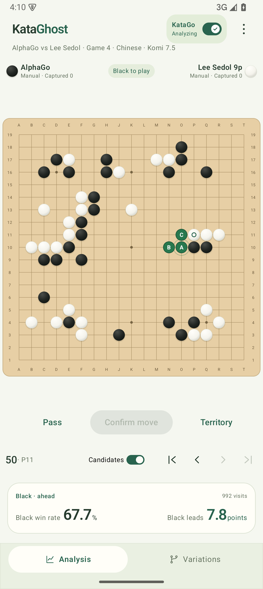
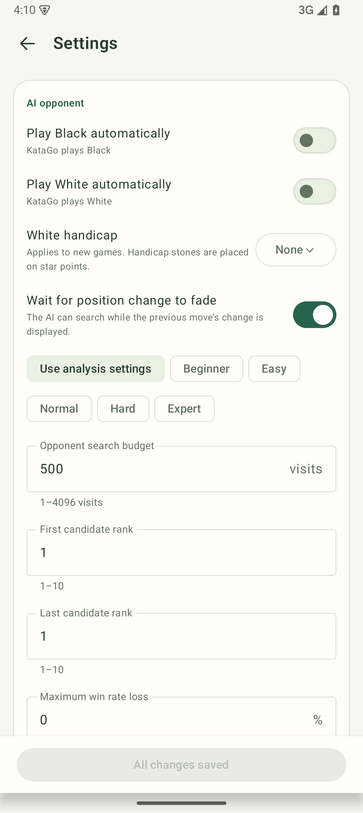
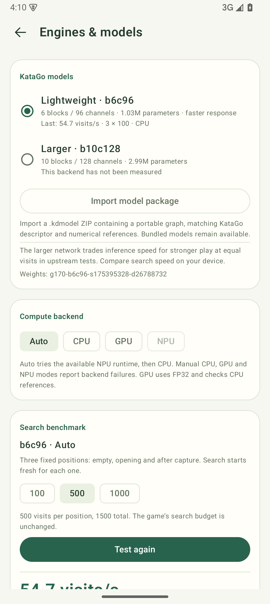

# KataGhost

<!-- current-version:start -->
KataGhost: **v0.2.1** · Android versionCode: **1004** · [Changelog](CHANGELOG.md)
<!-- current-version:end -->

KataGhost is an Android Go board with KataGo analysis, AI opponents and SGF review. It is maintained by Bianim. SGF files exported from other Go apps can be imported.

Copyright, upstream sources and dependency terms are centralized in
[third-party notices](THIRD_PARTY_NOTICES.md).

[简体中文](README.md) · [User guide](docs/android-ui.md) · [Architecture](docs/katago-integration.md) · [Performance](docs/models-and-benchmarks.md)

An Android Go board with offline KataGo analysis, variations and SGF editing.
The app runs the official KataGo search and rules engine locally, with LiteRT
neural inference. No account or analysis server is required.

<p align="center">
  
  
  
</p>

## Features

- Play either color manually, let KataGo play Black or White, or enable both for self-play.
- Toggle analysis from the top-right switch; configure the analysis search budget and AI opponent difficulty separately.
- Candidate colors reflect **win-rate loss relative to the best evaluated move**,
  from the player-to-move perspective: near-best green, then yellow, then red.
  Three near-equal opening moves can all be green at about 50% win rate.
- Hold a board candidate to preview its continuation. Use move navigation or the variations tree to revisit positions.
- Select an intersection and choose **Confirm move**. **Pass** and **Territory** sit below the board.
- Opening a game analyzes the current position first, then fills the whole SGF's
  history and variations for review.
  Once history is complete, the selected position keeps searching until KataGo is paused.
  Live search snapshots refresh about every 250 ms.
- Toggle candidate markers next to the move navigation controls.
- Import/export 19×19 SGF with variations, comments, player metadata and root setup stones.
  Player panels display SGF names and ranks (kyu, dan or professional).
- Chinese, Japanese and Korean rules; komi from −400 to 400, including decimals.
- Switch between bundled b6c96 and b10c128 networks, select Auto / CPU / GPU / NPU,
  and measure actual search **visits/s** on three fixed positions.
- English and Simplified Chinese interfaces, following Android's app/system language.

## How to use

Download from [GitHub Releases](https://github.com/Bianim/KataGhost/releases).
Choose **arm64-v8a** for phones and tablets, **x86_64** for x86 devices/emulators,
or the universal APK for both architectures. ARMv7 is not supported.

Build and install the app using the instructions below. Open the three-dot menu
to **Clear board**, **Import SGF**, **Export SGF** or open **Settings**. Tap an
intersection and confirm to play. The KataGo switch enables analysis; both colors are manual
by default. In Settings, edit the desired options and tap **Apply all changes**
once at the bottom. If automatic play is paused, tap **Resume auto** in the
player status area to continue. Open **Engines & models** to choose a model and
benchmark it.

The visit setting is the initial budget for each position. The app fills the
record history at that budget before continuously deepening the selected position.
Its visit counter can stay at 500 while historical positions are being analyzed.

Android 13+ supports choosing English or Chinese in system Settings → Apps →
KataGhost → Language. The app initially opens the first 50 moves of AlphaGo–Lee Sedol, game 4
(2016-03-13); analysis and candidate values come from real search.

## Device support

KataGhost can run on CPU. NPU use depends on the device and whether the build includes a compatible vendor runtime. See [NPU setup and verification](docs/npu.md) and [model and benchmark notes](docs/models-and-benchmarks.md).

## Build

Use Android Studio with API 37 support, or the Gradle wrapper. Toolchain:
Gradle 9.6.0, JDK 25 (Gradle daemon), Android SDK 37.0 (API 37), Build Tools 36.0.0,
NDK 28.2.13676358 and CMake 3.22.1. Java source compatibility is 11.
Set the SDK path through Android Studio or your own ignored `local.properties`.

```bash
./gradlew :app:assembleDebug
adb devices -l
adb -s <target-serial> install -r app/build/outputs/apk/debug/app-debug.apk
```

The included assets make a CPU build possible without Python, model downloads or
conversion tools. For the optional NPU plugins, see [NPU setup](docs/npu.md).
Release APKs require your own signing configuration; never commit signing keys.
Pushing a version tag such as `v1.0.0` builds signed arm64-v8a, x86_64 and
universal APKs and publishes them as a GitHub Release once the repository's signing secrets are configured. See
[tagged APK release setup](CONTRIBUTING.md#tagged-apk-releases).

```bash
python3 tools/check_integrity.py
./gradlew :app:testDebugUnitTest :app:lintDebug :app:assembleDebugAndroidTest
```

AVD instrumentation commands are in [CONTRIBUTING.md](CONTRIBUTING.md).

### How it works

Compose UI → game/SGF state → serialized analysis controller → JNI → official
KataGo rules, features and search → LiteRT inference on CPU, GPU or NPU.
Models and actual backends have separate result caches. Search and benchmark
jobs share a single worker, so cancelled jobs cannot publish stale moves or free
buffers while native inference still uses them.

See [architecture](docs/katago-integration.md) and [model conversion](docs/model-conversion.md).

## License

KataGhost code is [MIT](LICENSE). KataGo source, external libraries, CC0 g170
weights and vendor runtime terms are documented in [Third-party notices](THIRD_PARTY_NOTICES.md).
