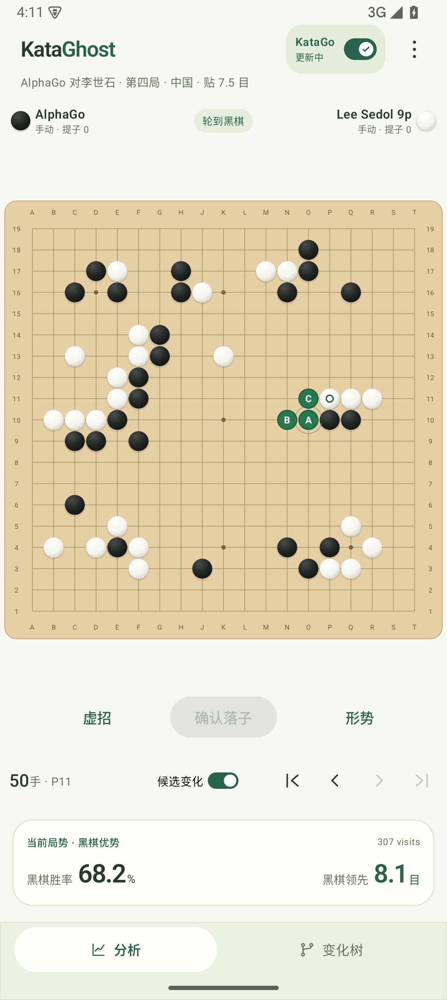
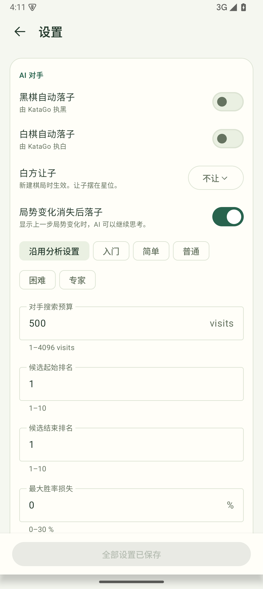
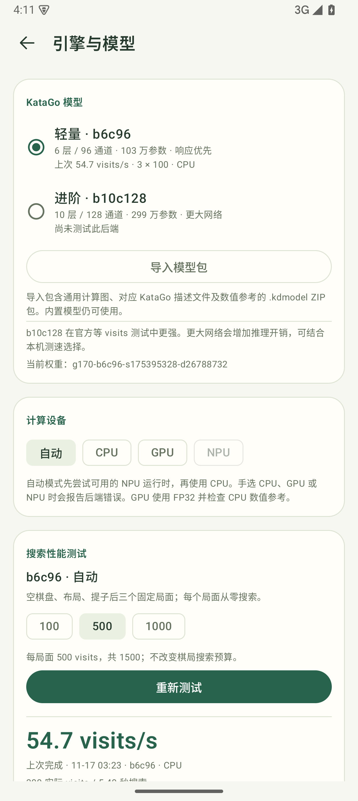

# KataGhost

<!-- current-version:start -->
KataGhost: **v0.2.2** · Android versionCode: **1005** · [Changelog](CHANGELOG.md)
<!-- current-version:end -->

KataGhost 是 Bianim 维护的 Android 围棋应用，提供 KataGo 分析、人机对弈和 SGF 复盘。其他围棋应用导出的 SGF 棋谱可直接导入。

版权、上游来源和依赖条款集中见[第三方声明](THIRD_PARTY_NOTICES.md)。

[English](README.en.md) · [使用说明](docs/usage.zh-CN.md) · [技术架构](docs/katago-integration.md) · [模型与性能](docs/models-and-benchmarks.md)

在 Android 上离线运行 KataGo，支持对弈、局面分析、变化树和 SGF 棋谱编辑。
使用官方 KataGo 的规则与搜索，通过 LiteRT 在本机完成神经网络推理，无需账号或分析服务器。

<p align="center">
  
  
  
</p>

## 功能

- 双方手动落子，或分别设置黑棋、白棋自动落子；双方开启时自动对弈。
- 右上角可快捷开启或关闭双方自动落子。分析搜索预算与 AI 对手难度独立设置。
- 候选点按**当前行棋方相对最佳选点的胜率损失**从绿、黄到红着色。
  开局约 50% 时，接近最佳的前三个选点可以全部为绿色。
- 长按棋盘上的候选点可预览变化，通过棋步按钮或变化树回看局面。
- 点选交叉点，再按「确认落子」；棋盘下方还可使用「虚招」和「形势」。
- 导入、导出 19 路 SGF，保留主线、变化、注释、棋手信息和根节点摆子。
  玩家栏显示棋谱中的姓名和级／段位（含职业段位）。
- 中国、日本、韩国规则，支持 −400 到 400 的任意小数贴目。
- 整谱历史分析完成后，持续加深当前选中的局面，直到关闭 KataGo；实时结果约每 250 毫秒刷新。
- 候选点可通过棋步导航旁的快捷开关控制。
- 内置 b6c96、b10c128 模型，支持自动 / CPU / GPU / NPU 选择与真实搜索 visits/s 测速。
- 中文和英文界面，跟随 Android 的应用语言或系统语言。

## 开始使用

从 [GitHub Releases](https://github.com/Bianim/KataGhost/releases) 下载。
手机和平板推荐 **arm64-v8a**，x86 设备或模拟器选择 **x86_64**；通用 APK 包含两种架构。
不支持 ARMv7。

安装后通过右上角三点菜单清空棋盘、导入或导出 SGF、进入设置。
点选棋盘交叉点并确认落子，双方默认手动。KataGo 会自动分析当前局面。
设置中的所有修改由底部「应用全部设置」统一保存；引擎页面可直接切换模型和测速。
首次启动显示 AlphaGo 对李世石第四局（2016-03-13）的前 50 手，停在第 50 手；
胜率和推荐点由引擎实际计算。

语言可以在 Android 系统设置 → 应用 → KataGhost → 语言中切换。
更多操作见[中文使用说明](docs/usage.zh-CN.md)。

## 设备支持

KataGhost 支持 CPU 推理。NPU 能否使用取决于设备和 APK 是否包含兼容的厂商运行时。详见 [NPU 配置和验证](docs/npu.md)与[模型和测速记录](docs/models-and-benchmarks.md)。

## 构建

需要支持 API 37 的 Android Studio，或使用 Gradle Wrapper：Gradle 9.6.0，Gradle 守护进程
JDK 25，SDK 37.0（API 37）、Build Tools 36.0.0、NDK 28.2.13676358、CMake 3.22.1。
通过 Android Studio 或本地 `local.properties` 设置 SDK 位置。模型已内置，CPU 构建无需 Python。

```bash
./gradlew :app:assembleDebug
adb devices -l
adb -s <目标序列号> install -r app/build/outputs/apk/debug/app-debug.apk
```

可选 NPU 准备见 [NPU setup](docs/npu.md)，验证命令见 [CONTRIBUTING.md](CONTRIBUTING.md)。
发布 APK 需自行配置签名，签名材料不应提交到仓库。

## 技术架构

Compose 界面 → 棋谱与 SGF 状态 → 串行分析控制器 → JNI → 官方 KataGo 规则、特征和搜索 → LiteRT 推理。
CPU、GPU 或 NPU 只负责网络推理，合法性、历史规则与搜索仍由 KataGo 完成。
按模型哈希和实际后端隔离分析缓存；搜索与测速共用串行工作线程，切换局面、模型或退出时取消旧任务。
详见[架构说明](docs/katago-integration.md)和[模型转换](docs/model-conversion.md)。

## 协议

项目原创代码使用 [MIT](LICENSE)。第三方源代码、CC0 g170 模型以及厂商运行库各自的许可见
[THIRD_PARTY_NOTICES.md](THIRD_PARTY_NOTICES.md)。
