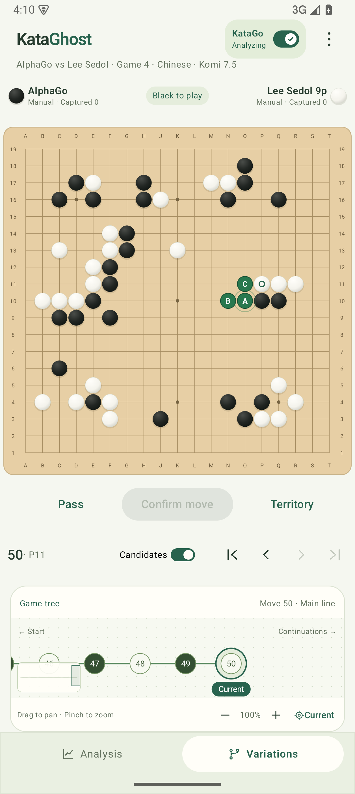

# Android interface

Tap a legal intersection to select it, then tap **Confirm move** to play. Tap a different intersection to adjust the selection. **Pass** plays a pass. **Territory** estimates ownership and shows score and captures. Tap **Back** to return to play.

Toggle **Candidates** beside the move navigation controls. Candidate letters follow search rank, with color indicating relative win-rate loss for the side to move. Long-press a marked intersection to preview its continuation. A recommended pass appears as a letter beside **Pass**.

The analysis panel shows win rate and score lead. When only Black is automated, it shows White's win rate. Otherwise it shows Black's. Move feedback switches from win-rate change to score change when either side reaches 95% before or after the move. Settings can make score change the default for every move.

An automatic pass is announced on the board before the next turn. Two consecutive passes open the result card, which shows the winner, margin, board counts and captures. Tap the card to close it.

The move controls and **Variations** tab let you revisit earlier positions and branches. The overflow menu offers SGF import/export, clearing the board, and settings.

In **Settings**, the AI opponent section controls automatic play separately for each color and has its own difficulty. The analysis search budget belongs to the engine section. The board section controls coordinates and candidate markers. See [game settings](game-settings.md) and [models and benchmarks](models-and-benchmarks.md).
