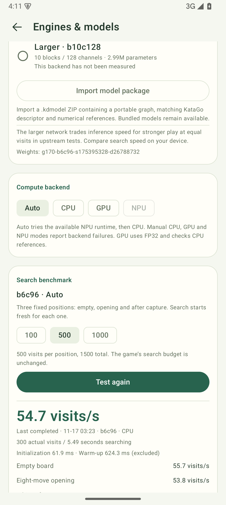

# Models and performance

[User guide](android-ui.md) · [Architecture](katago-integration.md) · [Conversion](model-conversion.md)

## Model choice

| Network | Size | Intended tradeoff |
| --- | --- | --- |
| b6c96 | 6 blocks, 96 channels, about 1.03M parameters | Lower inference cost and faster interactive analysis |
| b10c128 | 10 blocks, 128 channels, about 2.99M parameters | Larger network; stronger at equal visits in upstream g170 testing |

Both are older official g170 networks, paired with verified 19×19 version-8
TFLite exports. They are useful lightweight mobile baselines, not the latest or
strongest KataGo networks. Equal visits do not mean equal thinking time or equal
strength across networks. See the upstream [g170 network notes](https://katagoarchive.org/g170/neuralnets/README.txt).

The app allows switching these bundled pairs and importing optional `.kdmodel`
packages with a matching descriptor and CPU references. Version-17 PyTorch
transformer exports use the explicit contract described in
[model conversion](model-conversion.md#optional-transformer-packages). Importing
keeps the bundled models and default selection unchanged. Manual GPU mode uses
FP32 and a context-owning inference thread. Auto retains NPU-then-CPU selection.

## What visits/s measures

The engine page runs one 32-visit warm-up followed by fresh searches of an empty
board, an eight-move opening and a position after a capture. Each measured
position starts with the search tree and NN cache cleared. Choose 100, 500 or
1,000 visits **per position**. The benchmark's budget is separate from the game's
search setting.

Throughput is **total actual visits / total search time**, not an average of
individual rates, and not `1000 / neural inference latency`. Progressive visit
counts are cumulative and counted once. Initialization and warm-up are reported
separately and excluded from throughput. This is the single-threaded search used
by the app; serialization, JNI and synchronous inference contribute to its cost.

Models and actual CPU/GPU/NPU backends have separate saved results. Leaving the page,
cancelling or switching models invalidates an incomplete run. Auto results record
the backend that actually opened, including CPU fallback.

The screenshot shows a completed emulator run using Auto, which selected CPU.
The result illustrates the report and depends on the emulator host.

## 中文说明

引擎页面的 visits/s 是三个固定局面的实际搜索访问数除以搜索时间，初始化和预热另计。不同模型和计算后端的结果分别保存。此数值用于比较搜索速度，不能直接当作棋力指标。
